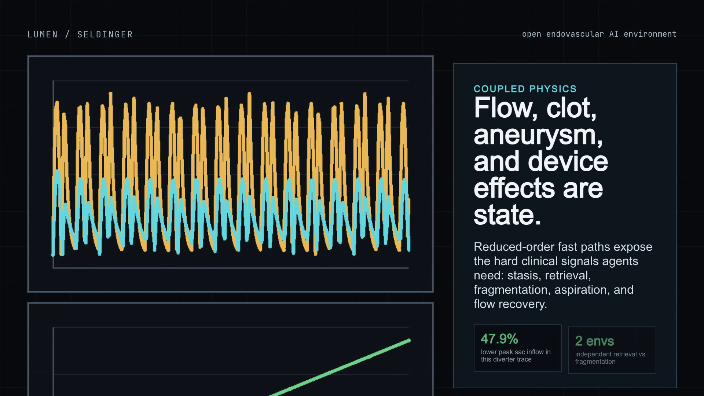

# Lumen

**Try image-only branch selection (CPU):** With Bash and [uv](https://docs.astral.sh/uv/) installed, run `bash tools/image_navigation.sh` from a clean checkout. The command installs the locked Python 3.12 solver environment, runs three procedural cases and replays their certificates. Open the printed `report.html` locally. Inspect each detector frame before revealing the trajectory and measurements. No model weights or GPU. [Experiment and audit guide](docs/IMAGE_BRANCH_EXPERIMENT.md).

**Train endovascular navigation against the vessel wall, not just the target.**

Lumen is an Apache-2.0 simulation and RL environment for catheter and guidewire navigation. It combines deformable vascular anatomy, finite-radius contact, synthetic imaging, replayable episodes, and Gymnasium tasks in one GPU-parallel solver.

[Launch page](https://seldingermed.github.io/seldinger-lumen/) · [Preprint](https://seldingermed.github.io/seldinger-lumen/assets/launch/lumen-preprint.pdf) · [Solver coverage](docs/SOLVER_SUPPORT.md)



## Try the static registration cases

[Open the blind projection](lumen/registration_pack/full-tree-v1/problem/image.png) and estimate the rigid pose of its supplied 3D tree. The [offline walkthrough](lumen/registration_pack/README.md) includes the camera convention, a standalone scorer in millimeters and pixels, and a separate answer overlay. No GPU or solver is needed.

In the [selective-exposure challenge](lumen/registration_pack/README.md#case-2-selective-exposures), different territories fill in the same 3D tree. Compare two rigid overlays that follow the visible forks but disagree in depth. In the [two-view challenge](lumen/registration_pack/README.md#case-3-one-injection-two-views), commit to a pose on the first image, then use a second calibrated projection to check it.

## Benchmark Snapshot

The historical 50,000-step branch-navigation pilot measured 100% raw target reach in
both native environments and 79.7 versus 12.1 evaluation steps/s for Lumen versus
CathSim. Its safety fields are **not cross-environment comparable**: Lumen recorded
centerline penetration in simulator units while CathSim recorded native contact force.
The current benchmark contract reports those endpoints separately; no cross-environment
safety claim is made until matched device/anatomy/material calibration and
force–injury validation exist. The frozen pilot artifacts remain available for
provenance and must not be reinterpreted under the new contract.

The full preprint and benchmark summaries are linked from the [launch page](https://seldingermed.github.io/seldinger-lumen/).

The scaled protocol is an explicit disjoint-case check:

```bash
lumen benchmark bench_results --suite scaled --episodes 100
```

It evaluates the same policy on frozen procedural train and held-out case IDs,
reports raw/native-safe/crash rates for each split, and records the train-minus-held-out
generalization gap in `forward-baseline-heldout.json`.

The suite version moves whenever the simulated dynamics change: the current suites are
`lumen-bench/8` and `lumen-bench/heldout/6`. Scorecards, replays and held-out reports
written under an earlier version are refused by the current validators; run the benchmark
again to produce them under the current version rather than relabelling old files.

Canonical scorecards also include episode-level `lumen-stats/1` summaries: fractional
interquartile means, ordinary means, and deterministic 95% percentile-bootstrap
intervals with recorded seeds and resample counts.

Generated scorecards include a SHA-256 certificate for every action sequence and native
episode outcome. Re-run the canonical baseline certificate locally with:

```bash
python tools/check_replay.py
```

Use `lumen.bench.replay_verified_leaderboard(results_dir, policies)` to rank only
scorecards whose certificates re-run successfully with the supplied policy callables.

## Install

```bash
git clone https://github.com/SeldingerMed/seldinger-lumen
cd seldinger-lumen
pip install -e ".[dev]"
lumen doctor
```

## CPU Docker image

The repository ships a CPU-only runtime image. It installs the pinned Newton/Warp
solver but does not require a CUDA device:

```bash
docker build --file docker/Dockerfile --tag seldinger-lumen:0.2.0 .
docker run --rm seldinger-lumen:0.2.0 anatomy --validate
```

## First Run

```bash
lumen play stenotic --out lumen-run
lumen benchmark lumen-bench
lumen anatomy --validate
lumen render-fluoro lumen-fluoro.png
lumen capture lumen-episodes
lumen validate lumen-episodes --require-cv-labels
lumen index lumen-episodes --out lumen-episodes/index.jsonl --check-sidecars
lumen split-index lumen-episodes/index.jsonl --out-dir lumen-episodes/splits
```

## Use your own scan

```bash
pip install -e ".[scan]"    # from your clone of this repository
lumen import /path/to/dicom-folder --out my-case
```

Lumen reads a CTA or MRA (DICOM, NIfTI or NRRD), finds and names the arteries, and writes
anatomy the solver can navigate. It picks the segmentation model for the body region and asks
before installing one. Everything runs on your machine. See [docs/import.md](docs/import.md).

## Real cases included

Five cases from public, openly licensed scans ship with Lumen (vessel geometry only, about
1 MB each): `head-cta-aneurysm`, `head-neck-cta`, `head-tof-mra`, `aorta-cta` and
`abdomen-cta`. `lumen cases` lists them with their credits; sources are in [NOTICE](NOTICE).

```python
from lumen import cases
env = cases.make_env("head-cta-aneurysm", "aneurysm")
```

## Look at anatomy and runs

```bash
lumen view head-cta-aneurysm                       # one HTML page; open it in a browser
lumen view head-cta-aneurysm --target aneurysm --run --save-run run.json
lumen view head-cta-aneurysm --replay run.json     # show a saved run again (same anatomy only)
lumen view arch --target carotid --run             # generated anatomy works the same way
lumen view head-tof-mra --look glass               # monitor (default), anatomy or glass
```

The page shows the vessels in 3D (drag to rotate) beside a simulated C-arm image, with AP,
lateral, LAO/RAO and cranial/caudal presets, and plays back a recorded run step by step. It is
a single self-contained file with no network access. `lumen view` takes a shipped case, a
folder written by `lumen import`, or generated anatomy (`arch`, `tortuous`, `bifurcation`,
`tube`). The 3D view has three looks: Monitor (dark, see-through red vessels), Anatomy
(solid vessels on a light page) and Glass (glowing, nearly clear walls).


## Python API

```python
import gymnasium as gym
import lumen.envs.registration

env = gym.make("Lumen/NavStenotic-v0")
obs, info = env.reset()
obs, reward, terminated, truncated, info = env.step(env.action_space.sample())
```

For standard RL libraries, the optional adapters preserve the Gymnasium contract:

```python
from lumen.rl import make_cleanrl_vector_env, make_sb3_env

sb3_env = make_sb3_env("Lumen/NavStenotic-v0", seed=0)
cleanrl_envs = make_cleanrl_vector_env("Lumen/NavStenotic-v0", num_envs=4, seed=0)
```

Install Stable-Baselines3 or CleanRL separately when using those trainers; the core
package keeps both integrations optional.

## Core systems

- Procedural stenotic, tortuous, aneurysmal, and branching vessels.
- Fixed-port guidewire and coaxial catheter actuation with rotation, latency, backlash, and motion limits.
- Deformable wall mechanics, finite-radius contact, anisotropic friction, flow, clot, retrieval, and flow diversion.
- Synthetic fluoroscopy, luminal RGB, masks, keypoints, noise, latency, and dropout.
- Dataset capture, validation, replay, indexing, splitting, and materialization.
- Privileged, tracked, and raw-image observation contracts for RL.
- Simulator/phantom/device deployment interface with fail-closed safety envelopes and
  force/torque benchtop validation ([protocol](docs/DEPLOYMENT.md)).

For offline measured-input phantom replay, including a runnable synthetic example and the capture/export checklist, see [Phantom replay](docs/PHANTOM_REPLAY.md).

## Citation

```bibtex
@software{son_lumen_2026,
  author = {Son, Colin},
  title = {Lumen: an Open, Differentiable, GPU-Parallel Environment for Endovascular AI},
  year = {2026},
  url = {https://github.com/SeldingerMed/seldinger-lumen},
  license = {Apache-2.0}
}
```

## License

Apache-2.0.
